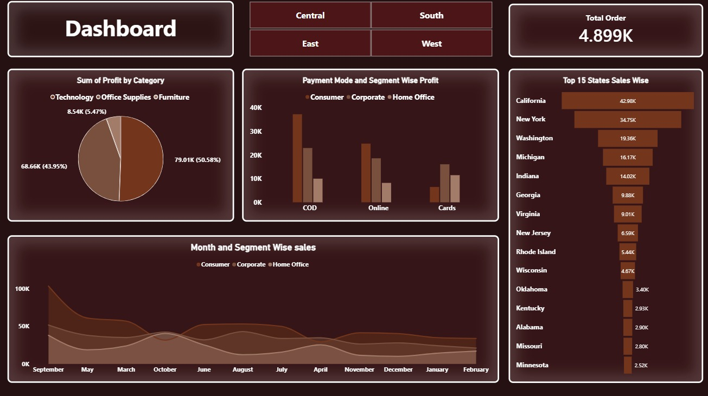

# Power-Bi-Basic-Sales-Project
The Power BI Sales Performance & Business Insights Dashboard is an interactive data visualization project developed using Microsoft Power BI.
The project focuses on analyzing sales performance, category-wise profitability, payment methods, customer segments, state-wise sales, and monthly sales trends.
The dashboard transforms raw sales data into meaningful visual insights, helping users understand business performance and identify opportunities for better decision-making.

## 🎯 Business Objectives
  The main objectives of this project are:
  Analyze overall order performance.
  Evaluate profit contribution across product categories.
  Compare profit across different payment modes and customer segments.
  Identify the top-performing states based on sales.
  Analyze monthly sales trends across customer segments.
  Explore regional performance using interactive filters.
  Generate meaningful business insights from sales data.

## 📊 Dashboard Preview

  
## 📈 Dashboard Visuals
 1. Profit by Category
    A pie chart showing the profit contribution of Technology, Office Supplies, and Furniture.

 2. Payment Mode and Segment-wise Profit
    A clustered column chart comparing profit across:
    - COD
    - Online
    - Cards

The analysis also compares Consumer, Corporate, and Home Office segments.

3. Top 15 States by Sales
   A bar chart highlighting the top 15 states based on sales performance.

4. Month and Segment-wise Sales
   An area chart displaying monthly sales trends across different customer segments.

 5. Regional Analysis
    Interactive region filters allow users to explore:
    - Central
    - South
    - East
    - West

  ## 💡 Key Business Insights
  Based on the dashboard:

1. Technology leads profitability: Technology contributes 50.58% of total category profit, making it the highest-performing category.
2. Office Supplies performance: Office Supplies contributes 43.95% of category profit.
3. Furniture opportunity: Furniture contributes 5.47% of category profit, indicating an area worth investigating for improvement.
4. State-wise performance: California records the highest sales among the displayed states, followed by New York and Washington.
5. Payment analysis: COD, Online, and Cards provide a comparison of profitability across customer segments.
6. Monthly trends: The month-wise sales visualization helps identify changes in sales performance across customer segments.

## 🛠️ Tools & Technologies

 Tool | Purpose 
 Microsoft Power BI | Dashboard Development 
 Data Visualization | Business Performance Analysis 

 ## 📁 Repository Structure
 
 Power-Bi-Basic-Sales-Project/
│
├── DashBoard.jpeg
│
├── Sample Project Data.xlsx
│
├── part-1.pbix
│
└── README.md

## 🚀 How to Run This Project
1. Download or clone this repository.
2. Download the `part-1.pbix` file.
3. Install Microsoft Power BI Desktop.
4. Open the PBIX file.
5. If required, update the Excel data source path.
6. Refresh the data.
7. Explore the dashboard and interact with the regional filters.

## 🏁 Conclusion
This project demonstrates how Microsoft Power BI can be used to convert sales data into meaningful business insights.

Through interactive visualizations, category-wise profit analysis, payment mode comparisons, state-wise sales analysis, and monthly sales trends, the dashboard provides a clear overview of business performance.

The project helped develop practical skills in data analysis, business intelligence, and dashboard development.
